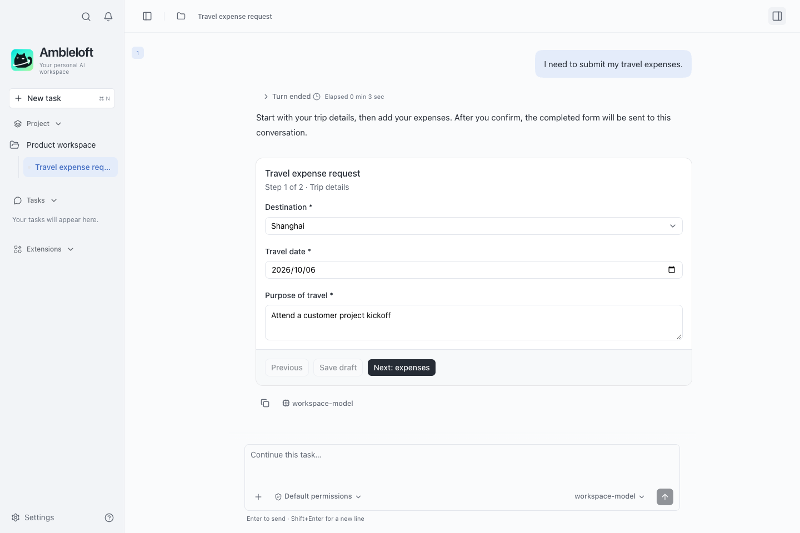
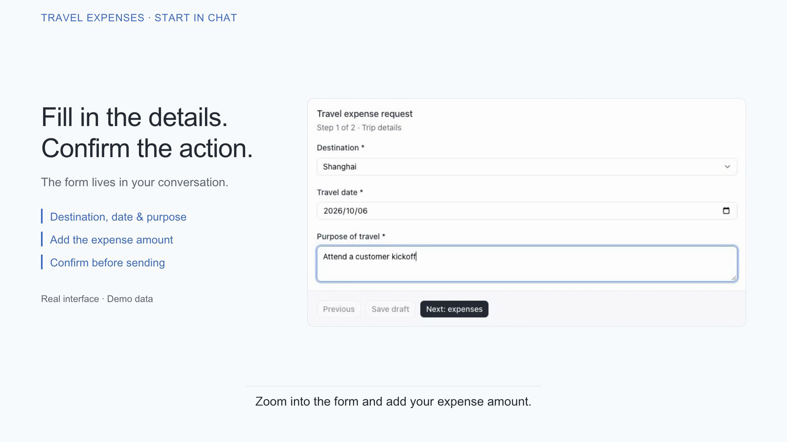
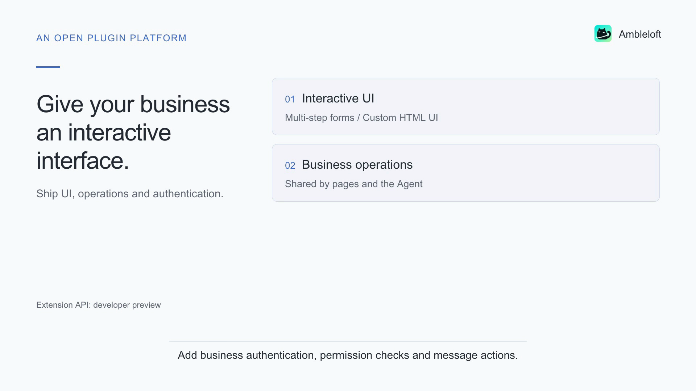
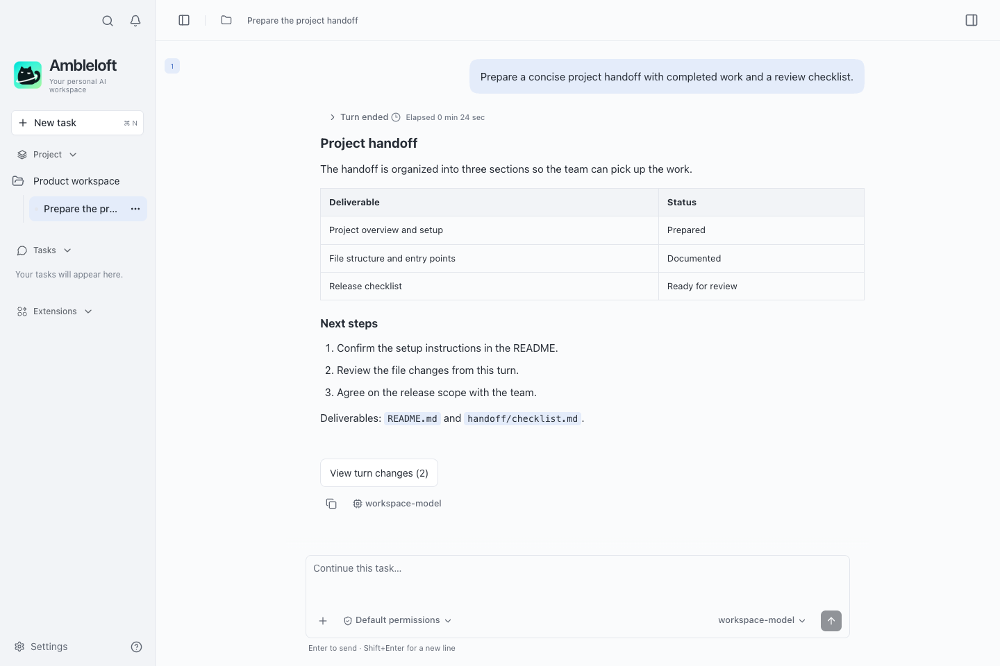

<div align="center">
  
  <h1>Ambleloft</h1>
  <p><strong>Bring your apps into AI conversations.</strong></p>
  <p>An open-source desktop AI agent and a foundation for software companies building their own business agents.</p>
  <p><a href="https://ambleloft.com/en/">Official website</a> · <a href="https://github.com/fjb040911/Ambleloft/releases">Downloads & release notes</a> · <a href="https://ambleloft.com/en/docs/overview/">Developer guides</a> · <a href="#start-with-skill-master">Create with Skill Master</a></p>
  <p><strong>English</strong> · <a href="README.zh-CN.md">简体中文</a></p>
</div>

Ambleloft is a free, open-source desktop AI agent and an open extension platform. Work with project files, review tool activity, confirm actions, and inspect results in conversation. Software teams can build on that workspace to give their existing products a conversational interface.

**Define the business entry point in a Skill. Specify fields and steps in a declarative form. Connect your services through a Node extension.** Your application owns the business rules and final outcome; Ambleloft provides the conversation, interaction components, and extension runtime.

This repository contains the **0.7.0 development preview**. For the capabilities described here, start with the [source setup](#run-from-source). Installer scope is documented in each release. The desktop core is free; model and external service charges are separate.

## The agent understands intent. Your software owns the rules.

A user asks: “Help me claim last week’s travel expenses.” Your team has already defined the required fields, validation, steps, and submission operation.

1. The Agent finds the form registered by your Skill and prefills facts already provided in the conversation.
2. The host renders the form. The user supplies missing details, moves between steps, and reviews their entries.
3. After confirmation, the form follows its configured submission path: send structured answers to chat, or invoke an extension operation.
4. For a business submission, the Node extension calls your finance service. Your service stores the request and provides a result that can be checked.

Sending answers to chat and submitting a claim to a finance system are distinct actions. You choose the path in the form definition and implement the business integration.



*Application UI with demo data and a simulated desktop bridge. This screenshot illustrates form interaction, not a production finance integration.*

### Define the form once, reuse it in conversation

Put fields, choices, validation, and steps in YAML alongside your `SKILL.md`. The Agent selects the template and supplies known information; the host handles rendering, drafts, and step navigation. Your team can version, test, and deliver the workflow with the rest of its software.

A standalone Skill can collect information and send confirmed answers to chat. Start there, then add an extension when the workflow needs your business service.

[Build a three-step form](https://ambleloft.com/en/docs/declarative-ui/) · [Host form contract](specs/extensions/declarative-forms-guide.md) · [Importable travel Skill](examples/skills/travel-expense/SKILL.md)

### Connect the software your customers already use

Use Node extensions to wrap existing APIs as business operations. Reuse JavaScript / TypeScript and npm libraries for your integration. An operation can serve both the extension interface and the Agent, subject to its declared callers and permissions.

CRM, ERP, finance, service-desk software, and internal services are integration targets. Each needs its own adapter, authentication, and business rules. The service remains responsible for authorization, persistence, deduplication, and result lookup.

[Connect a business operation](https://ambleloft.com/en/docs/operations/) · [Authentication example](https://github.com/fjb040911/ambleloft-extension-samples/blob/main/enterprise-auth/README.md)

### Keep people involved as work progresses

Subscribe to events from your business service and publish progress in Ambleloft’s message center. Add confirmed actions so users can review an update and take the next step. The service-event and message-action samples demonstrate these patterns independently.

The current source also supports project-authorized turn-completion Hooks and opt-in background summary jobs. These use a separate contract from business-service events; see the [automation guide](specs/extensions/background-automation-guide.md).

[Subscribe to service events](https://github.com/fjb040911/ambleloft-extension-samples/blob/main/service-events/README.md) · [Add message actions](https://github.com/fjb040911/ambleloft-extension-samples/blob/main/message-actions/README.md)

## A shared foundation for your business Agent

| You define | Ambleloft provides |
| --- | --- |
| Skills that describe when to use a business capability | Skill discovery and model tool calls |
| Form fields, validation, steps, and submission mappings | In-chat form rendering, drafts, navigation, and submission records |
| Operations that connect to your APIs | Node extension runtime, permission checks, and confirmation interactions |
| Service events and actions users can take | In-app messages and action handling |
| Your model endpoint and project context | Conversations, file access, execution review, and model connections |

For custom HTML/JS interfaces, use the supported [MCP Apps subset](specs/extensions/mcp-apps-design.md). Skills can also declare [editors and result collections](specs/extensions/declarative-ui-guide.md). Use [localization resources](specs/extensions/localization-design.md) to translate skills, templates, and notifications while retaining business values and identifiers.

The built-in [supplemental information Skill](resources/skills/supplemental-input/SKILL.md) helps the Agent ask for missing details during open-ended tasks. Developer-defined business forms use their own templates and contracts.

## Our direction: connect conversations, systems, and the people doing the work

We want software companies to deliver business Agents on a shared foundation, bringing their domain knowledge and existing services into conversation.

A service request is one example of that direction: identify the issue in chat, confirm details in a form, coordinate work through business systems and server-side services, then bring field updates back to the user. Desktop, server, and other device experiences should contribute to the same business process.

This is the product direction. Cross-device coordination and unattended server-side execution require further development and integration. Current SSH projects let the desktop Agent operate remote files and commands; they do not provide that whole future workflow.

[Explore the product vision on the website](https://ambleloft.com/en/#product-film) · [Check current source capabilities](specs/extensions/current-capabilities.md)

<details>
<summary>Watch the earlier form interaction demo (80 seconds)</summary>

[](https://github.com/fjb040911/Ambleloft/releases/download/v0.3.1/ambleloft-intro-en.mp4)

[English](https://github.com/fjb040911/Ambleloft/releases/download/v0.3.1/ambleloft-intro-en.mp4) · [简体中文](https://github.com/fjb040911/Ambleloft/releases/download/v0.3.1/ambleloft-intro-zh-CN.mp4). Both versions have captions and no audio.

This earlier video uses real application UI, demo data, and a simulated desktop bridge. Its two-step form returns answers to chat. The business-service example below uses a separate three-step flow and a local demo service.

</details>

## Choose your first step

| Your goal | Start here |
| --- | --- |
| Use the desktop Agent for a task | [Run from source](#run-from-source), then [connect a model](#connect-a-model) |
| Define a form in a Skill | [Declarative business form tutorial](https://ambleloft.com/en/docs/declarative-ui/) |
| Create a skill or connect a business service with AI guidance | [Start with Skill Master](#start-with-skill-master) |
| Work on a server project | [SSH remote projects](#work-on-your-server-projects-from-here) |
| Develop directly with the SDK | [Build your first extension](#build-your-first-extension) |
| Inspect the host’s contracts and boundaries | [Source documentation](specs/README.md) |

## Start with Skill Master

Describe the business outcome and provide the relevant API docs. The built-in Skill Master guides you through the decisions and helps generate editable skills, forms, and extension code.

1. Create a task in a **local project**, choose **Create skill / extension**, and send the prepared prompt. For example: “Let colleagues register service tickets in chat.”
2. Add API docs, field rules, and sanitized examples to the project, then ask the Agent to read them. Confirm the proposed fields, steps, and business actions as the guide progresses.
3. Review the generated files and check results. Approve installation from the creation card, configure the connection in extension settings, and try the workflow in chat.

Start with a Skill for reusable instructions or a defined business form. When the workflow needs a new service, tool, or device integration, Skill Master can recommend an extension and help define its execution model. Addresses and tool paths belong in extension settings; credentials use the host's supported credential entry. Source stays in your project for further changes and tests.

A successful package check does not verify your business service. Use a demo or read-only operation first, then check authentication, field mapping, and the real result before using business writes.

[Create with Skill Master](https://ambleloft.com/en/docs/skill-master/) · [Read the built-in guide](resources/skills/skill-master/SKILL.md)

## Work on your server projects from here

Create an **SSH remote project**, connect to your server, and select its project directory. Browse remote files, ask the Agent to inspect or change the project, and check commands in the integrated terminal. Your existing server toolchain remains the working environment.

Use a local project for the Skill Master creation and installation path above. SSH project access does not move locally installed extension backends onto the server.

The source preview also includes SSH-to-Docker project selection. This path has simulated integration coverage; validation against a real SSH and Docker environment remains pending.

[Explore remote projects](https://ambleloft.com/en/docs/remote-projects/) · [Docker scope and verification](specs/remote-workspaces/README.md)

## Build your first extension

Use JavaScript / TypeScript and npm packages to connect your app. Extensions combine isolated frontend pages with user-trusted Node.js backends. Bundle dependencies with the extension; users do not need to install Node or run npm. Native modules need platform and host ABI compatibility checks.

Start with the runnable [hello-operation sample](https://github.com/fjb040911/ambleloft-extension-samples/blob/main/hello-operation/README.md):

```bash
git clone https://github.com/fjb040911/ambleloft-extension-samples.git
cd ambleloft-extension-samples/hello-operation
npm ci
npm run build
npm run validate
npm test
npm run pack
```

In a compatible host, open **Settings → Extensions → Install**, select the package, confirm trust, and grant the required permissions. [Run the host from source](#run-from-source) for the current extension preview.

<details>
<summary>How an extension fits together</summary>



Use a Skill to describe when to use your capability, a form or page to collect input, and an operation to execute business logic. See the [current capabilities and contracts](specs/extensions/current-capabilities.md) for source-preview interfaces and runtime capability checks. The [declarative UI guide](specs/extensions/declarative-ui-guide.md) covers editors, collections, and their submission contract.

</details>

## Start with a working example

| Build this | Example |
| --- | --- |
| A multi-step form connected to a service | [Travel expense assistant](https://github.com/fjb040911/ambleloft-extension-samples/blob/main/expense-workflow/README.md) |
| A custom interface inside chat | [In-chat travel card](https://github.com/fjb040911/ambleloft-extension-samples/blob/main/mcp-apps-card/README.md) |
| Business progress updates | [Service events](https://github.com/fjb040911/ambleloft-extension-samples/blob/main/service-events/README.md) |
| Messages with confirmed actions | [Message actions](https://github.com/fjb040911/ambleloft-extension-samples/blob/main/message-actions/README.md) |
| Authenticated business integrations | [Authentication](https://github.com/fjb040911/ambleloft-extension-samples/blob/main/enterprise-auth/README.md) |
| Data processing with npm libraries | [CSV to JSON](https://github.com/fjb040911/ambleloft-extension-samples/blob/main/npm-data-transform/README.md) |

[Browse all examples](https://github.com/fjb040911/ambleloft-extension-samples)

<details>
<summary>Try the travel expense form</summary>
<a id="try-the-travel-expense-form"></a>

1. Start the host and connect a model with compatible tool calling.
2. Follow the [expense assistant guide](https://github.com/fjb040911/ambleloft-extension-samples/blob/main/expense-workflow/README.md) to build and install the extension.
3. Start its local demo service and configure the service URL in extension settings.
4. Ask to submit travel expenses, complete the three-step flow, and query the resulting records.

This sample uses fictional data and a local demo service. It also demonstrates read-only reconciliation after a lost response. The earlier form video above shows a separate two-step UI demo that returns input to chat.

</details>

## A workspace your extensions can build on

Ambleloft provides model connections, project files, conversation history, and execution approvals. Choose a compatible model service and bring the context your app needs.

| Foundation | Included |
| --- | --- |
| Models and context | Local, private-network, or cloud endpoints; Responses and Chat Completions adaptation; project folders and file attachments. |
| Remote projects | SSH project directories, remote file access, Agent commands, and an integrated terminal. |
| Execution and review | Tool activity, plans, approvals, stopping tasks, rich results, and per-turn file-change review. |
| Everyday work | Local history, archive search and restore, reusable Skills, file and Office previews. |
| Your workspace | English / Simplified Chinese, light / dark themes, adjustable panels, and grouped sidebar or activity-bar navigation. |

<details>
<summary>Workspace preview and navigation</summary>



*Application UI with synthetic project content and a simulated desktop bridge.*

Switch layouts in **Settings → General → Navigation layout**. The activity bar is the default. Switching layouts or activity groups keeps your current conversation and draft. The activity bar uses icons with tooltips and separate project, task, and extension entry points. Standalone tasks are grouped by time. Narrow windows use a sidebar drawer with Escape-to-close and focus restoration.

File diffs compare directory snapshots before and after a turn. They may include external edits and have size and count limits. They support review, not Git commits or rollback.

</details>

## Current preview

**0.7.0 development preview.** The current host source and its contracts define the capability baseline. Check each release’s notes for installer coverage.

- **Platforms:** macOS Apple Silicon is the primary validated environment. Windows and Linux require platform-specific build and native-runtime validation; check release notes for available packages.
- **Extensions:** forms, operations, isolated pages, settings, message actions, and OIDC integration are developer previews. MCP Apps support is a limited subset, not full ChatGPT Apps or arbitrary remote MCP compatibility.
- **Tooling:** use SDK/CLI and samples aligned with the host capability you are developing against. Follow the [extension setup guide](https://ambleloft.com/en/docs/first-extension/) and the selected sample’s dependency instructions. APIs are evolving and a marketplace is not available. The [automation guide](specs/extensions/background-automation-guide.md) documents project grants, model opt-in, and job limits.

Ambleloft connects to existing model endpoints. Model downloads and inference-runtime management are outside the current scope. Model and external service charges are separate.

[Capability reference](specs/extensions/current-capabilities.md) · [Sample verification](https://github.com/fjb040911/ambleloft-extension-samples/blob/main/docs/verification.md) · [Changelog](CHANGELOG.md)

## Run from source

Requirements: macOS, **Node.js 22.13+** (Node.js 24 LTS recommended), and npm. The engine preparation step builds for the host architecture.

```bash
git clone https://github.com/fjb040911/Ambleloft.git
cd Ambleloft
npm ci
npm run engine:prepare
npm run dev
```

Ambleloft uses the pinned Codex app-server runtime from the official npm package. You do not need to install the Codex CLI or the official Codex/ChatGPT desktop apps. The runtime is downloaded/prepared locally and is not committed to this repository.

For a production frontend build:

```bash
npm run build
npm start
```

`npm run dev:web` starts a browser-only UI preview. Native filesystem access and agent execution require the desktop app.

## SSH projects and integrated terminal

Create an SSH project to browse remote files and run Agent commands through SSH/SFTP while the Agent stays on your computer. Password, private-key, and local SSH-agent authentication are supported. First connections require host-key confirmation; changed fingerprints block connections. Remote writes and commands require approval in default permission mode.

Open the integrated terminal from **View → Open Terminal**, **Ctrl + backtick**, or a folder's context menu. Sessions are grouped by project and remain active when the panel is hidden. Local and SSH terminals support tabs, search, resizing, and theme-aware colors.

SSH projects currently target Linux servers with Bash and SFTP. Jump hosts, MFA, port forwarding, and terminal process recovery after a disconnect are not supported. Build and native-runtime validation must run on each target OS and architecture; this release provides macOS Apple Silicon binaries.

<details>
<summary>Office previews: dependencies and supported features</summary>

## Office previews

The desktop app previews `.xlsx` / `.xls` workbooks and `.pptx` / `.ppt` presentations from the project file panel or the preview button on a delivered file. Previews are read-only.

- Excel: worksheet tabs, formatted saved cell values, and virtualized rows. Formula recalculation, charts, merged-cell layout, and full Excel styling are not included.
- PowerPoint: slide thumbnails, page navigation, fit/percentage zoom, and PPTX speaker notes. Legacy `.ppt` files display slides without notes. Animations are not played; font substitution can affect appearance.
- PowerPoint conversion requires **LibreOffice** on the user's machine. On macOS, install it in `/Applications` or `~/Applications`; other installations can use `PATH` or the `AMBLELOFT_SOFFICE` environment variable. LibreOffice is not bundled with Ambleloft. Missing installations show an actionable error and leave external opening available.
- Visible files are checked every two seconds. Changes are debounced before conversion; the last successful preview remains visible while updating or after an error. The refresh button retries. Files outside the active preview are converted when opened.
- Content-based previews are cached under the app's `office-preview` data directory (up to 12 recent entries). Conversion uses a separate temporary profile and does not modify the source document.
- Limits: 32 MiB source files, 500 PPTX slides, up to 100 sheets / 10,000 rows / 200 columns, 200,000 cells overall, and an approximate 8 MiB text budget. Truncated spreadsheet previews are labeled.

After building, run `npm run test:office` for a real Electron/LibreOffice preview smoke test. Unit tests cover parsing, cache reuse, conversion failures, and file access boundaries.

</details>

## Connect a model

1. Open **Settings → Model providers → Add service**.
2. Enter the provider's Base URL, exact model ID, and API key. A local service without authentication may use an empty key.
3. Choose the appropriate protocol, save, and test the connection. Connection tests send a small request and may incur provider charges.
4. Start a conversation, optionally selecting a project folder, and send a task.

Use a base URL such as `https://api.example.com/v1`, without appending `/responses` or `/chat/completions`. Public endpoints require HTTPS; HTTP is allowed for supported localhost and private-network addresses. Agent tasks require compatible tool calling. Native web search requires a Responses provider that supports it.

## Data and execution

“Local-first” describes where the workspace is stored; it does **not** mean every model runs locally. Prompts, selected files, and tool context may be sent to your configured model service.

- API keys are encrypted using Electron safeStorage and are not returned to the renderer.
- The default execution mode starts read-only and asks for approval when writes or elevated access are required. Optional full access allows actions without individual approval.
- A project folder is working context, not a guarantee that it is the only readable location.
- The app maintains a separate engine configuration and does not reuse the official Codex application's login or configuration.
- For compatibility with earlier development builds, macOS data remains under `~/Library/Application Support/Atelier`, including `atelier.sqlite` and a separate `codex-home`. Browser preview data is separate.

<details>
<summary>Packaging and development checks</summary>

## Build a Mac application

```bash
npm run package:mac   # Build the .app for the current Mac architecture
npm run dist:mac      # Build .app, DMG, ZIP and checksums in release/
```

Local packages use ad-hoc signing and are not Apple-notarized distribution builds. For a signed and notarized release, configure Developer ID signing and Apple notarization credentials, then run `npm run release:mac`.

## Development and validation

Built with Electron, React, TypeScript, and Vite.

```bash
npm test                         # Unit and local integration tests
npx playwright install chromium
npm run test:e2e                  # Browser UI tests
npm run test:desktop              # Desktop smoke test with a local model fixture
npm run test:codex                # Pinned engine integration tests
npm run test:credentials          # Credential persistence across restarts
node scripts/capture-readme.mjs   # Recreate screenshots using installed Chrome and demo data
```

Desktop checks run on macOS and may use the system keychain. Local test fixtures do not establish compatibility with every external model provider.

Internal planning (`docs/`), generated deliverables (`output/`, `outputs/`), dependencies, runtime binaries, user data, and build outputs are intentionally excluded from Git. Runtime assets are prepared by the setup/build scripts.

</details>

## Feedback and contributions

Please [open an issue](https://github.com/fjb040911/Ambleloft/issues) with reproduction steps, app version, operating system version, and provider/protocol details. Remove API keys, private files, and sensitive conversation content before sharing logs. Discuss substantial changes in an issue before starting a pull request.

## License and acknowledgements

Ambleloft is licensed under [Apache-2.0](LICENSE). Third-party components retain their own licenses; see [THIRD_PARTY_NOTICES.md](THIRD_PARTY_NOTICES.md).

Ambleloft is an independent project, not an official OpenAI product. It uses the Codex runtime, Electron, React, Vite, Lucide, and other open-source libraries.
