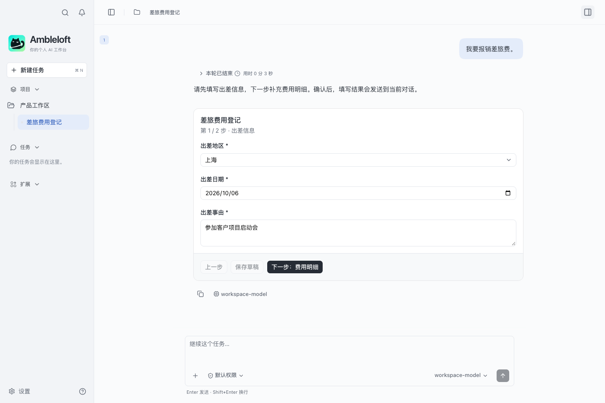
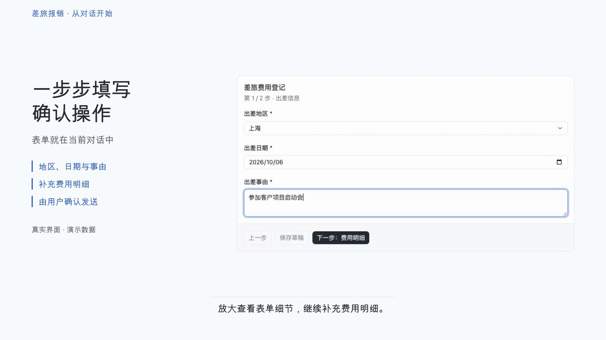
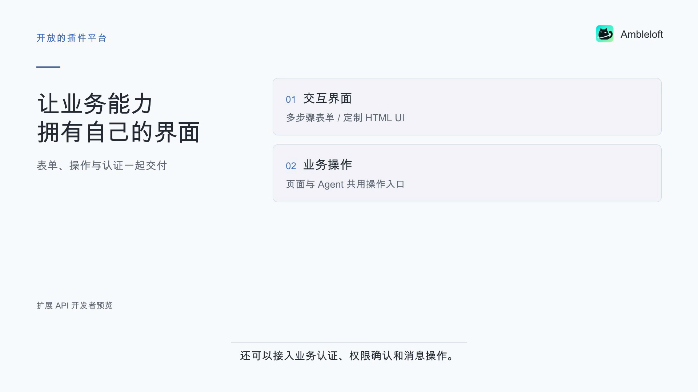
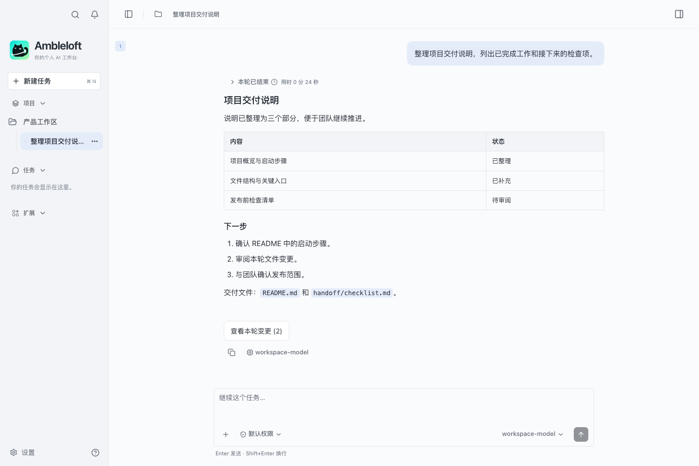

<div align="center">
  
  <h1>Ambleloft</h1>
  <p><strong>把你的应用，带进 AI 对话。</strong></p>
  <p>开源免费的桌面 AI Agent，为软件公司构建自己的业务 Agent 提供底座。</p>
  <p><a href="https://ambleloft.com/zh/">官方网站</a> · <a href="https://github.com/fjb040911/Ambleloft/releases">下载与发行说明</a> · <a href="https://ambleloft.com/zh/docs/overview/">开发教程</a> · <a href="#推荐从技能大师开始">跟随技能大师创建</a></p>
  <p><a href="README.md">English</a> · <strong>简体中文</strong></p>
</div>

Ambleloft 是开源免费的桌面 AI Agent，也是面向软件公司构建业务 Agent 的开放扩展平台。用户可以通过对话处理项目文件、查看工具活动、参与操作确认并审阅结果。软件团队可以基于这个工作台，为已有产品增加对话式业务入口。

**用 Skill 定义业务入口，用声明式表单确认信息，通过 Node 扩展连接你的服务。** 你的应用掌握业务规则与最终处理结果，Ambleloft 提供对话、交互组件和扩展运行环境。

本仓库提供 **0.8.0 开发预览**。体验本文所述能力，请先[从源码运行](#从源码运行)；安装包的功能范围以对应发行说明为准。桌面核心免费，模型及外部服务费用另计。

## 模型理解意图，你的软件掌握业务

用户说：“帮我报销上周的差旅费。”你的团队已经定义好这项业务需要哪些字段、如何校验、分几步填写，以及怎样提交。

1. Agent 找到 Skill 注册的表单，预填对话中已经提供的信息。
2. 宿主渲染表单，用户补充缺项、前后切换步骤并核对填写内容。
3. 用户确认后，按表单配置将结构化答案发送到聊天，或调用扩展的业务操作。
4. 需要提交业务时，Node 扩展调用财务服务，由服务保存申请并提供可核对的处理结果。

将答案发送到聊天与提交到财务系统是两种不同的动作。开发者在表单中选择提交方式，并实现相应的业务对接。



*应用界面使用演示数据和模拟桌面接口。截图展示表单交互，不代表已接入生产财务系统。*

### 定义一份表单，在对话中反复使用

把字段、选项、校验和步骤写进 YAML，与 `SKILL.md` 一起维护。Agent 负责选择模板、带入已知信息；宿主负责展示、草稿和步骤导航。你的团队可以像维护软件一样，对业务流程进行版本管理、测试和交付。

独立 Skill 就能收集信息，并把确认后的答案发送到聊天。先从这条路径开始；需要连接业务服务时，再加入扩展。

[编写三步业务表单](https://ambleloft.com/zh/docs/declarative-ui/) · [宿主表单契约](specs/extensions/declarative-forms-guide.md) · [可导入的差旅 Skill](examples/skills/travel-expense/SKILL.md)

### 让现有软件，拥有新的交互入口

通过 Node 扩展，把已有 API 封装成业务 Operation，复用 JavaScript / TypeScript 和 npm 库完成接入。同一个操作可按声明的调用方和权限，供扩展界面及 Agent 使用。

CRM、ERP、财务、售后工单和企业内部服务，都可以成为对接对象。每项集成需要对应的适配、认证和业务规则；授权、持久化、去重与结果查询仍由业务服务负责。

[接入业务 Operation](https://ambleloft.com/zh/docs/operations/) · [认证接入示例](https://github.com/fjb040911/ambleloft-extension-samples/blob/main/enterprise-auth/README.zh-CN.md)

### 业务继续推进，用户随时参与

订阅自己业务服务的事件，把进展送到 Ambleloft 消息中心。为消息附上需经确认的操作，让用户查看变化后继续处理。服务事件和消息操作案例分别展示了这两种接入方式。

当前源码还支持按项目授权的轮次完成 Hook，以及用户主动开启的后台摘要作业。这与业务服务事件使用独立的契约，详见[自动化指南](specs/extensions/background-automation-guide.md)。

[订阅服务事件](https://github.com/fjb040911/ambleloft-extension-samples/blob/main/service-events/README.zh-CN.md) · [添加消息操作](https://github.com/fjb040911/ambleloft-extension-samples/blob/main/message-actions/README.zh-CN.md)

## 在共同底座上，构建自己的业务 Agent

| 你定义 | Ambleloft 提供 |
| --- | --- |
| Skill 描述业务能力的使用时机 | 技能发现与模型工具调用 |
| 表单字段、校验、步骤与提交映射 | 聊天内表单、草稿、步骤导航和提交记录 |
| 连接业务 API 的 Operation | Node 扩展运行环境、权限校验与确认交互 |
| 业务服务事件与用户可执行的操作 | 应用内消息与操作处理 |
| 模型端点和项目上下文 | 会话、文件访问、执行审阅与模型连接 |

需要自定义 HTML/JS 界面时，可以使用当前支持的 [MCP Apps 子集](specs/extensions/mcp-apps-design.md)。Skill 也可以声明[编辑器和结果集合](specs/extensions/declarative-ui-guide.md)。通过[本地化资源](specs/extensions/localization-design.md)翻译技能、模板和通知，同时保持业务值与身份标识不变。

应用内置的[补充信息 Skill](resources/skills/supplemental-input/SKILL.md)帮助 Agent 在开放式任务中询问缺失信息。开发者定义的业务表单使用自己的模板和契约。

## 我们的方向：让对话、系统与现场协同工作

我们希望成为软件公司开发自己业务 Agent 的底座，让团队把行业知识和已有服务带入对话。

一次售后服务可以体现这个方向：从聊天中了解故障，用表单确认信息，通过业务系统和服务器服务推进处理，再把现场进展带回用户。桌面、服务器与其他终端应共同参与同一条业务流程。

这是产品的发展方向，跨终端协作和服务器自主持续执行仍需要后续建设与业务适配。当前 SSH 项目支持桌面 Agent 操作远端文件和命令，并不等于上述完整流程已经交付。

[在官网了解产品愿景](https://ambleloft.com/zh/#product-film) · [核对当前源码能力](specs/extensions/current-capabilities.md)

<details>
<summary>观看早期表单交互演示（80 秒）</summary>

[](https://github.com/fjb040911/Ambleloft/releases/download/v0.3.1/ambleloft-intro-zh-CN.mp4)

[中文版](https://github.com/fjb040911/Ambleloft/releases/download/v0.3.1/ambleloft-intro-zh-CN.mp4) · [English](https://github.com/fjb040911/Ambleloft/releases/download/v0.3.1/ambleloft-intro-en.mp4)。两个版本均带字幕，无音轨。

此早期视频使用真实应用界面、演示数据和模拟桌面接口，两步表单将答案带回聊天。下方业务服务案例使用另一套三步流程和本地演示服务。

</details>

## 选择你的起点

| 你想做什么 | 从这里开始 |
| --- | --- |
| 用桌面 Agent 完成任务 | [从源码运行](#从源码运行)，然后[连接模型](#连接模型) |
| 在 Skill 中定义表单 | [声明式业务表单教程](https://ambleloft.com/zh/docs/declarative-ui/) |
| 跟随 AI 引导创建技能或连接业务服务 | [推荐从技能大师开始](#推荐从技能大师开始) |
| 在服务器项目中开发 | [SSH 远程项目](#项目在服务器上也能在这里开发) |
| 直接使用 SDK 开发 | [开发第一个扩展](#开发第一个扩展) |
| 核对宿主接口与能力边界 | [源码文档](specs/README.md) |

## 推荐从技能大师开始

说出你想实现的业务，提供相关接口文档。内置技能大师会逐步引导关键决策，辅助生成可编辑的技能、表单和扩展代码。

1. 在**本地项目**中新建任务，点击「**创建技能 / 扩展**」，发送准备好的引导提示。例如：“让同事在聊天里登记售后工单。”
2. 把接口说明、字段规则和脱敏示例放入项目，让 Agent 读取。跟随引导，确认建议的字段、步骤和业务操作。
3. 审阅生成的文件与检查结果，在创建卡中确认安装。按需在扩展设置中配置连接，再回到聊天试用。

复用指令或收集固定业务信息，可以先创建 Skill。需要新增服务、工具或设备接入时，技能大师会建议扩展，并协助明确执行方式。地址与工具路径放在扩展设置中，凭据使用宿主支持的凭据入口。源码保留在项目中，便于继续修改和测试。

产物检查通过不代表真实业务接入已验证。先用演示或只读操作试用，核对认证、字段映射与实际结果后，再使用业务写入。

[跟随技能大师创建](https://ambleloft.com/zh/docs/skill-master/) · [查看内置引导](resources/skills/skill-master/SKILL.md)

## 项目在服务器上，也能在这里开发

创建 **SSH 远程项目**，连接服务器并选择项目目录。你可以浏览远端文件，让 Agent 检查或修改项目，再通过集成终端核对命令结果，继续使用服务器上已有的工具链。

上方技能大师的创建与安装流程使用本地项目。SSH 项目访问不会将本机已安装的扩展后台迁移到服务器运行。

源码预览还提供 SSH 进入 Docker 容器后选择项目目录的能力。目前已通过模拟集成测试，真实 SSH 与 Docker 环境验收仍待完成。

[了解远程项目](https://ambleloft.com/zh/docs/remote-projects/) · [Docker 范围与验证记录](specs/remote-workspaces/README.md)

## 开发第一个扩展

使用 JavaScript / TypeScript 和 npm 包连接你的应用。扩展包含隔离的前端页面和经用户信任后运行的 Node.js 后端。依赖随扩展交付，用户无需另装 Node 或运行 npm；原生模块需要适配目标平台和宿主 ABI。

从可运行的 [hello-operation 案例](https://github.com/fjb040911/ambleloft-extension-samples/blob/main/hello-operation/README.zh-CN.md)开始：

```bash
git clone https://github.com/fjb040911/ambleloft-extension-samples.git
cd ambleloft-extension-samples/hello-operation
npm ci
npm run build
npm run validate
npm test
npm run pack
```

在兼容宿主中打开「**设置 → 扩展 → 安装**」，选择生成的扩展包，确认信任并授予所需权限。体验当前扩展预览能力，请先[从源码运行宿主](#从源码运行)。

<details>
<summary>一个扩展如何组成</summary>



用 Skill 描述 Agent 何时使用你的能力，用表单或页面收集输入，再由操作执行业务逻辑。详见[当前能力与契约](specs/extensions/current-capabilities.md)。

</details>

## 从一个完整案例开始

| 你想实现的能力 | 示例 |
| --- | --- |
| 连接业务服务的多步骤表单 | [差旅报销助手](https://github.com/fjb040911/ambleloft-extension-samples/blob/main/expense-workflow/README.zh-CN.md) |
| 聊天内自定义界面 | [差旅交互卡片](https://github.com/fjb040911/ambleloft-extension-samples/blob/main/mcp-apps-card/README.zh-CN.md) |
| 业务进展通知 | [服务事件订阅](https://github.com/fjb040911/ambleloft-extension-samples/blob/main/service-events/README.zh-CN.md) |
| 带确认操作的消息 | [消息操作](https://github.com/fjb040911/ambleloft-extension-samples/blob/main/message-actions/README.zh-CN.md) |
| 需要认证的业务系统对接 | [认证接入](https://github.com/fjb040911/ambleloft-extension-samples/blob/main/enterprise-auth/README.zh-CN.md) |
| 使用 npm 库处理数据 | [CSV 转 JSON](https://github.com/fjb040911/ambleloft-extension-samples/blob/main/npm-data-transform/README.zh-CN.md) |

[浏览全部案例](https://github.com/fjb040911/ambleloft-extension-samples)

<details>
<summary>体验差旅表单</summary>
<a id="体验差旅表单"></a>

1. 启动宿主，连接支持兼容工具调用的模型。
2. 按[报销助手指南](https://github.com/fjb040911/ambleloft-extension-samples/blob/main/expense-workflow/README.zh-CN.md)构建并安装扩展。
3. 启动本地演示服务，在扩展设置中填写服务地址。
4. 在聊天中请求报销差旅费用，完成三步流程，再查询申请记录。

案例使用虚构数据和本地演示服务，也展示响应丢失后的只读核实流程。上方早期表单视频使用另一套两步 UI 演示，将输入结果带回聊天。

</details>

## 扩展所需的工作台，已经准备好

Ambleloft 提供模型连接、项目文件、会话历史和执行审批。选择兼容的模型服务，为你的应用带入所需上下文。

| 基础能力 | 已提供 |
| --- | --- |
| 模型与上下文 | 本地、局域网或云端端点，Responses 与 Chat Completions 适配，项目目录和文件附件。 |
| 远程项目 | SSH 项目目录、远端文件访问、Agent 命令与集成终端。 |
| 执行与审阅 | 工具活动、计划、审批、停止任务、丰富结果展示和逐轮文件变更审阅。 |
| 日常工作 | 本地历史、归档搜索与恢复、可复用技能、文件及 Office 预览。 |
| 个性工作区 | 中英文、浅色/深色主题、可调面板，以及分组侧栏或活动栏导航。 |

<details>
<summary>工作台预览与导航方式</summary>



*应用界面使用虚构项目内容和模拟桌面接口。*

在「**设置 → 通用 → 导航布局**」切换布局，默认使用活动栏。切换布局或活动栏分组会保留当前聊天和输入草稿。活动栏采用图标及悬浮提示，分别提供项目、任务和扩展入口；独立任务按时间分组。窄窗口使用侧栏抽屉，支持 Escape 关闭和焦点恢复。

文件差异通过比较本轮执行前后的目录快照生成，可能包含外部修改，并有大小和数量限制。它用于审阅，不执行 Git 提交或回滚。

</details>

## 当前预览范围

**0.8.0 开发预览。** 以当前宿主源码和契约为能力基线；安装包覆盖范围以对应发行说明为准。

- **平台：**macOS Apple Silicon 是当前主要验证环境。Windows、Linux 需要分别完成构建与原生运行时验证，安装包以发行说明为准。
- **扩展：**表单、操作、隔离页面、设置、消息操作及 OIDC 认证均处于开发者预览。MCP Apps 支持有限子集，不代表兼容完整 ChatGPT Apps 或任意远程 MCP。
- **工具：**SDK/CLI 与示例应对齐所开发能力的宿主基线。按[扩展入门教程](https://ambleloft.com/zh/docs/first-extension/)及所选案例的依赖说明准备工具。API 仍在演进，商城尚未开放；项目授权、模型开关和作业额度见[自动化指南](specs/extensions/background-automation-guide.md)。

Ambleloft 连接已有模型端点，不负责模型下载和推理运行时管理。模型及外部服务费用另计。

[能力参考](specs/extensions/current-capabilities.md) · [示例验证记录](https://github.com/fjb040911/ambleloft-extension-samples/blob/main/docs/verification.md) · [更新说明](CHANGELOG.md)

## 从源码运行

需要 macOS、**Node.js 22.13+**（建议 Node.js 24 LTS）及 npm。引擎准备步骤使用当前机器的架构。

```bash
git clone https://github.com/fjb040911/Ambleloft.git
cd Ambleloft
npm ci
npm run engine:prepare
npm run dev
```

应用使用官方 npm 包中的固定版本 Codex app-server 引擎，无需另外安装 Codex CLI、官方 Codex 或 ChatGPT 桌面应用。引擎在本机下载、准备，不提交到本仓库。

运行生产前端构建：

```bash
npm run build
npm start
```

`npm run dev:web` 仅提供浏览器界面预览。本地文件访问和 Agent 执行需要桌面应用。

## SSH 远端项目

创建项目时选择「SSH 远端项目」，填写主机/IP、端口、用户名及认证信息，保存并测试连接，再浏览或填写服务器上的项目目录。支持密码、私钥和本机 SSH Agent；首次连接显示服务器指纹，确认后固定记录，指纹变化会阻止连接。凭据默认只留在本次应用内存中，勾选记住后通过系统安全存储加密保存，不发送给模型。

Agent 在本机运行，通过 SSH/SFTP 读取、搜索、修改远端文件和执行命令，无需在服务器安装 Agent。默认权限下，写入和命令执行需在聊天中批准；完全访问模式允许直接操作远端。文本写入校验读取版本，发现已变更时拒绝覆盖。文件树支持远端浏览、预览及下载；终端自动进入远端项目目录。每个 Agent 命令使用独立的登录 Bash，返回标准输出、错误输出和退出码。

应用启动时 SSH 连接保持未连接；切换项目和后台文件刷新不主动建连。点击连接、测试连接、浏览远端目录、打开远端终端或启动远端 Agent 任务时建立连接。同一连接配置在项目与窗口间共享；切换项目、收起面板不会断开。每 15 秒通过 SSH 协议发送保活请求，允许 3 次未响应，超限后关闭连接；连接、错误和关闭事件同步到各窗口。意外掉线最多重连 5 次，等待间隔为 1、2、4、8、16 秒；认证失败或指纹异常停止重试。手动断开会取消重连，后台读取不会重新建立连接。正在执行的命令不会自动重跑，已退出的终端保留输出，重连后需新建终端。收起面板会保留活跃会话，退出应用会关闭连接。

当前面向提供 Bash 和 SFTP 的 Linux 服务器。尚不支持跳板机、多因素认证、端口转发、断线后的终端进程恢复，以及远端产物自动归档和完整差异面板（可使用远端 Git）。本地附件需先自行上传；本地扩展操作不会在 SSH 任务中开放。客户端代码支持 macOS/Windows/Linux，真实服务器和桌面集成已在 macOS 验证，其他平台仍需原生验证。

开发者可通过标准输入向 `scripts/test-ssh-remote.cjs` 或 `scripts/test-ssh-desktop.mjs` 提供连接 JSON（`host`、`username`、`password`、`path`、`fingerprint`）；请使用隐藏输入，勿将凭据写入仓库。远端测试仅在独立临时目录验证写入并清理，项目目录只读。

## 内置终端

桌面版通过顶部菜单「视图 > 打开终端」或 `Ctrl + 反引号` 打开底部面板；文件树中的文件夹右键菜单也提供「在此处打开终端」。入口不常驻主工具栏，终端界面按需加载。

终端在当前窗口内按项目分组，新会话优先使用任务工作目录（包括 worktree），未关联项目时使用用户主目录。同项目切换聊天、切换项目或收起面板不会结束进程；“结束终端”、关闭窗口或退出应用会清理对应终端。应用重启不自动重跑命令。

支持多标签、Shell 选择、搜索、复制粘贴、清屏、拖动高度和最大化。macOS/Linux 使用登录 Shell，Windows 优先 PowerShell 7，再回退 Windows PowerShell 或 CMD。WSL 暂无专用集成。终端颜色默认跟随应用的浅色、深色或系统主题。

运行 `npm run build && npm run test:terminal` 验证真实桌面终端。打包前会使用目标 Electron 运行时检查原生 PTY；必须在目标系统和架构上构建。Linux 使用 `npm run package:linux` 或 `npm run dist:linux`，首次安装原生依赖需要系统 C++ 编译工具和 Python。macOS 已有本机桌面与应用包验证，Windows/Linux 仍需在对应系统执行验证。

<details>
<summary>Office 预览：依赖与支持范围</summary>

桌面应用可从项目文件面板或交付文件的预览按钮打开 Excel（`.xlsx` / `.xls`）及 PowerPoint（`.pptx` / `.ppt`），预览均为只读。

- Excel 支持工作表切换、已保存的格式化单元格值及虚拟滚动；不重新计算公式，不完整还原图表、合并单元格和样式。
- PowerPoint 支持缩略图、翻页、缩放及 PPTX 演讲者备注；旧版 PPT 不显示备注，不播放动画，字体替换可能影响外观。
- PowerPoint 转换需要另外安装 **LibreOffice**，应用不内置该软件。macOS 可安装到 `/Applications` 或 `~/Applications`，也可通过 `PATH` 或 `AMBLELOFT_SOFFICE` 指定位置。未安装时会提示，仍可使用外部应用打开。
- 当前预览文件每两秒检查一次变化，更新失败时保留上次成功的预览，也可手动刷新。转换不修改源文件，缓存最多保留 12 个最近条目。
- 文件上限为 32 MiB；PPTX 最多 500 页；表格最多 100 个工作表、10,000 行、200 列，总计 200,000 个单元格，文本预算约 8 MiB。截断时会显示提示。

</details>

## 连接模型

1. 打开「设置 → 模型提供商 → 添加服务」。
2. 填入 Base URL、准确模型 ID 和 API Key；无鉴权的本地服务可留空密钥。
3. 选择适用协议，保存并测试连接。测试会发送少量请求，可能产生服务费用。
4. 新建对话，可选项目文件夹，然后发送任务。

Base URL 示例为 `https://api.example.com/v1`，不要追加 `/responses` 或 `/chat/completions`。公网端点要求 HTTPS；支持的本机与局域网地址可使用 HTTP。Agent 任务需要模型支持兼容的工具调用；原生网页搜索需要支持该能力的 Responses 服务。

## 数据与执行权限

「本地优先」描述工作台数据的存储方式，并不意味着模型一定在本地运行。提示词、所选文件和工具上下文可能发送到你配置的模型服务。

- API Key 通过 Electron safeStorage 加密保存，不回传渲染进程。
- 默认执行模式从只读开始，写入或提权需要审批。可选的完全访问模式允许不经逐次审批执行操作。
- 项目目录是工作上下文，并不保证它是唯一可读目录。
- 应用维护独立的引擎配置，不复用官方 Codex 的登录与配置。
- 为兼容早期开发版本，macOS 数据仍位于 `~/Library/Application Support/Atelier`，包含 `atelier.sqlite` 和独立的 `codex-home`。浏览器预览数据与桌面版分离。

<details>
<summary>打包与开发验证</summary>

## 构建 Mac 应用

```bash
npm run package:mac   # 构建当前 Mac 架构的 .app
npm run dist:mac      # 在 release/ 生成 .app、DMG、ZIP 和校验文件
```

本地包使用 ad-hoc 签名，不是经过 Apple 公证的正式分发版本。正式签名与公证发布需要配置 Developer ID 签名及 Apple 公证凭据，再运行 `npm run release:mac`。

## 开发与验证

技术栈：Electron、React、TypeScript 和 Vite。

```bash
npm test                         # 单元与本地集成测试
npx playwright install chromium
npm run test:e2e                  # 浏览器界面测试
npm run test:desktop              # 使用本地模拟模型服务的桌面冒烟测试
npm run test:codex                # 固定版本引擎集成测试
npm run test:credentials          # 重启后的密钥持久化验证
node scripts/capture-readme.mjs   # 使用已安装的 Chrome 和演示数据重新截图
```

桌面验证在 macOS 上运行，可能使用系统钥匙串。本地模拟服务测试不代表对所有第三方模型服务的兼容性保证。

内部规划 `docs/`、生成产物 `output/`、`outputs/`、依赖、引擎二进制、用户数据和构建输出不提交 Git。运行所需资源由初始化与构建脚本准备。

</details>

## 反馈与贡献

欢迎[提交 Issue](https://github.com/fjb040911/Ambleloft/issues)，附上复现步骤、应用版本、操作系统版本和模型服务/协议信息。分享日志前请移除密钥、私有文件及敏感对话。较大的改动请先通过 Issue 讨论，再提交 PR。

## 许可证与致谢

Ambleloft 使用 [Apache-2.0](LICENSE) 许可证。第三方组件保留各自许可证，参见 [THIRD_PARTY_NOTICES.md](THIRD_PARTY_NOTICES.md)。

Ambleloft 是独立项目，并非 OpenAI 官方产品。项目使用 Codex 引擎、Electron、React、Vite、Lucide 等开源组件。

源码预览：Agent 可以在聊天框上方请求[持久化补充表单](specs/extensions/user-input-u9-results.md)，用户也可在任务运行时追加文字。内置引导 Skill 可停用；模型调用前探测 `input_capabilities`。这不是新增 Node SDK API，也不代表已支持独立执行单元调度。
